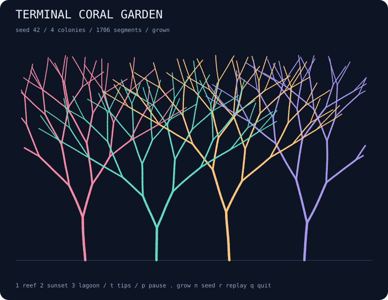

# terminal-coral-garden

Grow a little reef in your terminal. Seeded colonies branch upward, divide into delicate fans, and settle into a colorful garden.



## Run

```bash
npx --yes github:b69ca/terminal-coral-garden
npx --yes github:b69ca/terminal-coral-garden --seed 7 --colonies 5 --spread 0.5
```

Node.js 20 or newer. Zero runtime dependencies. Everything runs locally.

## Play

| Key | Action |
| --- | --- |
| `p` / Space | Pause or resume |
| `.` | Pause and grow one tick |
| `1` / `2` / `3` | Reef / sunset / lagoon palette |
| `t` | Toggle active-tip markers in the terminal |
| `n` | Grow the next seed |
| `r` | Replay the current seed |
| `+` / `-` | Faster / slower growth display |
| `q` / Ctrl-C | Quit and restore the terminal |

Each tick extends every active tip once. A completed reef stays visible until you replay it or choose another seed. Palette changes affect appearance only. Replay and next seed restore the startup palette. Tip-marker visibility stays as selected; SVG always shows active tips.

Live mode uses an alternate screen and restores the cursor and input mode on exit. `--no-color` or `NO_COLOR=1` disables ANSI colors. Dimensions fit the terminal at startup; very small terminals may clip the minimum grid.

## Export

```bash
npx --yes github:b69ca/terminal-coral-garden --seed 42 --svg reef.svg
npx --yes github:b69ca/terminal-coral-garden --steps 20 --svg young-reef.svg
npx --yes github:b69ca/terminal-coral-garden --seed 42 --json
npx --yes github:b69ca/terminal-coral-garden --frames 100
```

| Option | Range / default |
| --- | --- |
| `--seed N` | 0–4294967295; default 42 |
| `--colonies N` | 1–7; default 4 |
| `--depth N` | 2–7; default 5 |
| `--spread N` | 0.15–0.75 radians; default 0.38 |
| `--palette NAME` | reef, sunset, lagoon; default reef |
| `--width N` | 24–120; export default 80 |
| `--height N` | 12–60; export default 36 |
| `--steps N` | 0–10000; live default 0, export default 100 |
| `--frames N` | 0–100000; finite terminal session |
| `--json` | Print a summary |
| `--svg FILE` | Save a vector illustration |
| `--no-color` | Disable terminal colors |
| `--help` | Show usage |

A hundred ticks finishes every supported configuration, while `--steps 0` shows the starting tips. The frame counter stops when growth completes, so it can be smaller than the requested step count. JSON and SVG may be combined; neither accepts `--frames`. Piped output shows at most one plain snapshot without escape sequences. Live sessions draw the starting state first and grow between frames; paused and completed display frames count toward a finite frame limit. Exit codes: 0 success, 2 argument or file error.

## How it works

A local seeded PRNG places one root per colony along the seabed. Active tips grow short line segments with small angular jitter. After 6–9 segments, a branch splits into two children at opposite angles. Children inherit their colony, use shorter segments, and increase their branching depth. Tips stop at the depth limit or field boundary. Angles stay upward, so new segments never grow downward.

The 1.6 × 1 field, geometry, and growth sequence are independent of terminal dimensions. ASCII rasterizes line segments and marks active tips with `*`; SVG uses tapered vector strokes on a fixed 800 × 620 canvas. Increasing spread creates wider fans. Colony colors cycle after four colonies.

This is procedural branching artwork inspired by coral. There are no nutrient, light, water, or biological growth models. Branches may cross or overlap, including between colonies. Geometry stays fixed after it is grown; only new tips extend.

JSON reports configuration, growth completion, segment counts, active tips, deepest branch, and normalized growth height. It omits full geometry, which remains available in the library as `segments`, `tips`, and `roots`.

## Library

Install with `npm install github:b69ca/terminal-coral-garden`, then:

```js
import { createWorld, step, analyze, renderSVG } from 'terminal-coral-garden';
const world = createWorld({ seed: 42, colonies: 4, depth: 5 });
step(world, 100); // Mutates and returns world; stops when complete.
console.log(analyze(world));
const svg = renderSVG(world);
```

`render(world, { color: false, tips: true })` returns a terminal snapshot. The library also exports `palettes`. Changing `world.palette` to a supported value is allowed. Other internal state should stay intact. Each segment has a `parent` index pointing to an earlier segment in the same colony, or −1 for the first segment at a root.

## Development

```bash
npm ci
npm run check
```

Tests check determinism, tree topology, bounds, upward growth, finite completion, palette independence, CLI errors, and exports. GitHub Actions runs Node.js 20, 22, and 24.

## License

MIT
